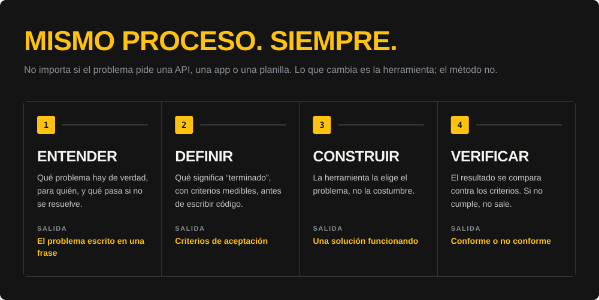
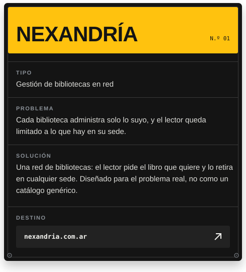
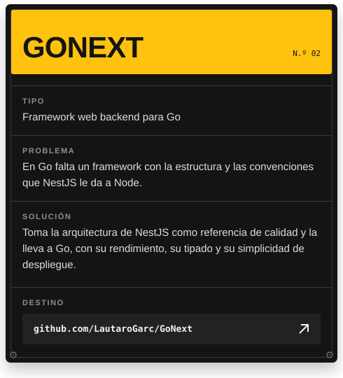

  

 

  

<h3>Proyectos</h3>

Cada uno con la misma placa: qué problema resuelve y cómo. Hacé clic en una placa para ir al proyecto.

  
  

<h3>Lista de piezas</h3>

Las herramientas con las que ejecuto el método. Las elige el problema.

<table>
<tr><td><b>Lenguajes</b></td><td>      </td></tr>
<tr><td><b>Frameworks</b></td><td>         </td></tr>
<tr><td><b>Mobile</b></td><td> </td></tr>
<tr><td><b>Servidor y datos</b></td><td>    </td></tr>
<tr><td><b>Entorno</b></td><td>   </td></tr>
<tr><td><b>Diseño</b></td><td>  </td></tr>
<tr><td><b>Seguridad</b></td><td></td></tr>
</table>

 

  
    
  

 

Este perfil también pasó por el método.

